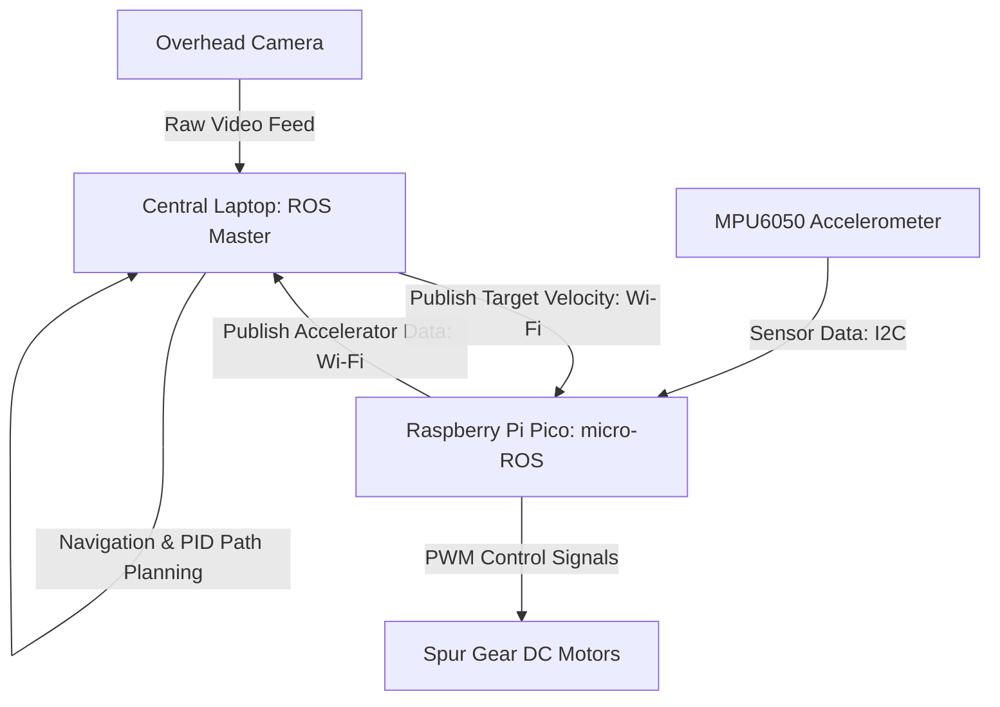

# Methodology

## 4.1 Hardware Architecture and Component Selection

The physical chassis of the robotic platform adopts a cylindrical geometry to facilitate rotation within confined spatial envelopes, drawing structural design principles from the multi-vehicle platform presented by \citet{yu2017portable}. Integrating three distinct cutouts, the base plate features two arch-shaped apertures accommodating the primary differential wheels alongside a third rectangular opening for a passive caster wheel that maintains vertical stability. Structural fabrication utilizes three-dimensional (3D) printing techniques to support rapid prototyping and low-cost replication. An open-top design characterizes the casing, which employs thickened mounting structures to secure the microcontroller. Convective airflow promoted by this open configuration cools internal electronics and provides direct physical access to the motor terminals. Soldered connections are applied to all electrical interfaces to maximize conductivity and minimize the probability of short-circuits during high-acceleration maneuvers.

The physical dimensions of the platform are constrained by the RoboCup Small Size League (SSL) regulations, which mandate that all participating robots must fit within a cylinder of 180 mm diameter and 150 mm height \citep{ssl_rules_2026}. Remaining comfortably within these limits, the proposed design utilizes a footprint of 100 mm diameter and 100 mm height. Symmetrical cylinders minimize rotational inertia and simplify the 3D-printing process relative to asymmetric geometries. Internal space accommodates a Raspberry Pi Pico microcontroller board, which measures 51 mm by 21 mm. Running micro-ROS, this board executes a specialized client library enabling microcontrollers to communicate directly with a central Robot Operating System (ROS) environment \citep{macenski2022robot}. Low unit cost and compatibility with hardware extension boards, such as Wi-Fi and camera modules, support modular hardware scaling. Although an onboard camera is excluded from the initial prototype to minimize cost, the physical chassis design reserves mounting space to accommodate future computer vision integration.

Locomotion is driven by two spur gear Direct Current (DC) motors, representing a mechatronic configuration modeled after the motor drive systems analyzed by \citet{salem2013}. Spur gear motors are selected due to their affordability, general availability, and integrated internal gearheads, which increase output torque at low rotational velocities. To track and regulate the dynamic motion of the platform in real time, the chassis houses an MPU6050 three-axis accelerometer. This sensor communicates with the microcontroller via an Inter-Integrated Circuit ($I^2C$) interface and fits within a compact spatial footprint, facilitating mounting near the center of mass of the robot to collect accurate acceleration data.

## 4.2 Distributed Software Stack and Communication

The control software is structured around the Robot Operating System (ROS) and its microcontroller-compatible extension, micro-ROS, which establish a distributed publisher-subscriber communication network \citep{macenski2022robot}. Primary computational operations, including navigation and path-planning algorithms, run on a centralized laptop serving as the ROS master node. Velocity vectors calculated by this master node are published as movement commands to specific command topics. Subscribing to these topics, the micro-ROS client running on the Raspberry Pi Pico translates the velocity commands into motor control signals for execution. Closing the feedback loop, the microcontroller publishes local acceleration data from the MPU6050 accelerometer back to the ROS master node. Sensor streams received by the master node are integrated into the central controller to dynamically adjust subsequent velocity commands.

Position and orientation tracking are achieved via an external overhead camera system. Overhead detection relies on a unique visual marker, or sigil, affixed to the top of the robot chassis, which allows the tracking software to resolve the coordinate position and heading angle of the vehicle in real time. This localization framework follows the multi-vehicle tracking pipeline described by \citet{yu2017portable}. Coordinate streams are processed by the central laptop to determine the position of the robot relative to the SSL playing field, serving as the input for path-generation algorithms. Figure 4.1 illustrates this distributed system architecture and the data pipeline mapping raw camera coordinates and accelerometer feedback to wheel velocities.

*Figure 4.1: Distributed system architecture and data pipeline.*

To regulate motor speeds and minimize tracking errors, the microcontroller implements a Proportional-Integral-Derivative (PID) control algorithm. Control input $u(t)$ sent to the motor drivers is defined as:
$$u(t) = K_p e(t) + K_i \int_{0}^{t} e(\tau) d\tau + K_d \frac{de(t)}{dt}$$
where $e(t) = v_{\text{target}}(t) - v_{\text{measured}}(t)$ is the difference between the target velocity commanded by the ROS master and the actual velocity measured by the MPU6050 accelerometer. Experimental tuning determines the PID parameters $K_p$, $K_i$, and $K_d$ to prevent overshoot and maintain controller stability under rapid deceleration profiles. Selection of the PID algorithm is justified by its low computational overhead, which fits within the processing constraints of the Raspberry Pi Pico microcontroller, and its established effectiveness in mobile robot speed regulation as demonstrated by \citet{pacheco2015testing}.

## 4.3 Benchmarking Protocols and Experimental Setup

Performance evaluation is conducted by comparing the manufactured differential-drive robot against a standard laboratory TurtleBot. Baseline parameters are established by subjecting the TurtleBot to an identical battery of tests, defining the target benchmarks for the proposed platform. If the TurtleBot fails to meet the operational standards defined by the RoboCup SSL rules, the official league specifications serve as the primary benchmarking reference \citep{ssl_rules_2026}.

The first benchmark evaluates the maximum velocity sustained by the vehicle, denoted as $v_{\text{max}}$. Calculation of this value utilizes the maximum change in displacement over time:
$$v_{\text{max}} = \max \frac{\Delta d}{\Delta t}$$
measured over a straight-line trajectory of 5 meters. This metric is necessary because RoboCup SSL rules restrict maximum robot velocity to $1.5\text{ m/s}$ to ensure safety and prevent high-speed collisions on the field \citep{ssl_rules_2026}.

The second benchmark measures the stopping time, $t_{\text{stop}}$, which evaluates the efficiency of the deceleration control loop. Stopping time is defined as the elapsed time between the transmission of a halt command, $t_{\text{halt}}$, and the moment the robot's velocity reaches zero, $t_{\text{zero}}$:
$$t_{\text{stop}} = t_{\text{zero}} - t_{\text{halt}}$$
Compliance with the SSL regulations is determined by this metric, which mandates a maximum stopping grace period of 2.0 seconds after a halt command is broadcast to maintain game control \citep{ssl_rules_2026}.

The third benchmark assesses the trajectory accuracy of the platform using an M-shaped path test. Path fidelity, $E_{\text{path}}$, is quantified using the root-mean-square error (RMSE) between the target path coordinates and the actual coordinates tracked by the overhead camera:
$$E_{\text{path}} = \sqrt{\frac{1}{N} \sum_{i=1}^{N} \left[ (x_i - \hat{x}_i)^2 + (y_i - \hat{y}_i)^2 \right]}$$
where $(x_i, y_i)$ represents the target coordinate pair at step $i$, and $(\hat{x}_i, \hat{y}_i)$ represents the coordinates recorded by the vision system. Tracking performance evaluates the ability of the non-holonomic differential-drive platform to execute sharp turns and maintain precise trajectory tracking under tight spatial constraints.

The fourth benchmark measures command response delay, or latency, denoted as $\tau_{\text{latency}}$. Latency computation uses the difference:
$$\tau_{\text{latency}} = t_{\text{motion}} - t_{\text{command}}$$
where $t_{\text{command}}$ is the exact timestamp when a motion command is sent from the ROS master, and $t_{\text{motion}}$ is the timestamp when the onboard accelerometer registers physical movement exceeding a baseline threshold. Quantifying this delay is necessary to verify the real-time communication performance of the ROS and micro-ROS message bridge under active play conditions \citep{kronauer2021latency}.

The fifth benchmark measures the stopping distance, $d_{\text{stop}}$, which is the physical displacement traveled after a deceleration command is issued. Euclidean distance is used to calculate the stopping distance between the position of the robot when the halt command is issued and its final resting position:
$$d_{\text{stop}} = \|\mathbf{p}(t_{\text{halt}}) - \mathbf{p}(t_{\text{zero}})\|$$
where $\mathbf{p}(t)$ represents the two-dimensional position vector of the robot. Characterizing stopping distance is required to evaluate the safety of the deceleration control profile and ensure the vehicle can avoid obstacles and field boundaries when halted.

The sixth benchmark determines the turning radius, $R_{\text{turn}}$, to establish the minimum spatial envelope required for direction changes. Measurement of this metric requires a physical marker to be attached to the outermost edge of the robot chassis so that it contacts the ground. Rotation of the robot is commanded through a 180-degree angle, and the radius of the resulting arc drawn on the surface is measured. Establishing this turning radius allows the central path-planning algorithms to calculate valid trajectories that avoid collisions with other robots on the playing field.

The final benchmark measures system consistency by computing the statistical dispersion of the collected metrics. Statistical analysis involves executing 10 iterations of each test and calculating the standard deviation, $\sigma_x$, for each performance metric:
$$\sigma_x = \sqrt{\frac{1}{n-1} \sum_{j=1}^{n} (x_j - \bar{x})^2}$$
where $x_j$ is the metric value recorded in iteration $j$, $\bar{x}$ is the mean value across all iterations, and $n = 10$. Evaluating this dispersion is necessary to determine the reproducibility of the robot's physical performance, ensuring that the control algorithms can rely on predictable mechanical responses.
